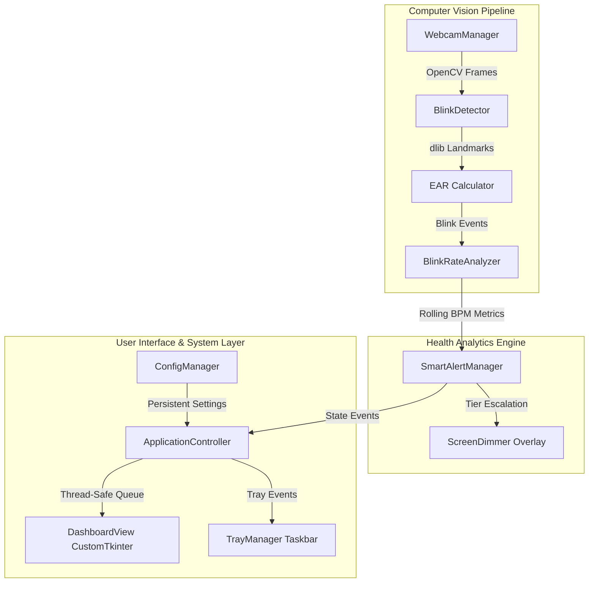

# Ocolyx 👁️⚡

<p align="center">
  
</p>

<p align="center">
  <strong>Intelligent Cyber-Eye Defense & Blink-Rate Telemetry for Windows</strong>
</p>

<p align="center">
  <em>Combat Computer Vision Syndrome (CVS) and Digital Eye Strain through real-time, privacy-first computer vision and adaptive micro-break interventions.</em>
</p>

<p align="center">
  <a href="https://github.com/Lakshmi-Narasimha176/Ocolyx/releases/latest">
    
  </a>
  <a href="https://github.com/Lakshmi-Narasimha176/Ocolyx/releases">
    
  </a>
  <a href="https://www.python.org/downloads/">
    
  </a>
  <a href="#test-suite">
    
  </a>
  <a href="#privacy-first-guarantee">
    
  </a>
</p>

---

## 🌐 Launch Web App & Download

<p align="center">
  <a href="https://lakshmi-narasimha176.github.io/Ocolyx/">
    
  </a>
  &nbsp;&nbsp;&nbsp;&nbsp;
  <a href="https://github.com/Lakshmi-Narasimha176/Ocolyx/releases/latest/download/Ocolyx-Windows.zip">
    
  </a>
</p>

> [!TIP]
> - **Web Version**: Run directly in your browser with zero installs at **[lakshmi-narasimha176.github.io/Ocolyx](https://lakshmi-narasimha176.github.io/Ocolyx/)**.
> - **Desktop App**: Single-file portable `.exe` for Windows with background system tray integration and full desktop screen dimming.

---

## 📖 Table of Contents

- [The Problem: Computer Vision Syndrome](#-the-problem-computer-vision-syndrome)
- [How Ocolyx Works](#-how-ocolyx-works)
- [Key Features](#-key-features)
- [End-User Setup & Installation](#-end-user-setup--installation)
- [Application Walkthrough](#-application-walkthrough)
- [Configuration Reference](#-configuration-reference)
- [Privacy-First Guarantee](#-privacy-first-guarantee)
- [Developer Setup](#-developer-setup)
- [Building the Executable](#-building-the-executable)
- [Architecture & Data Pipeline](#-architecture--data-pipeline)
- [Documentation & Resources](#-documentation--resources)
- [Contributing](#-contributing)

---

## 🔬 The Problem: Computer Vision Syndrome

During standard desk tasks and conversations, healthy adults blink on average **15–20 times per minute**, replenishing the tear film across the cornea. 

When focusing intently on digital monitors, reading code, or gaming, the natural blink rate drops precipitously to **3–5 blinks per minute**. This chronic under-blinking induces:
- Severe corneal dryness and ocular inflammation
- Blurred vision and refractive fatigue
- Tension headaches and eye strain
- Premature visual fatigue during long work sessions

Traditional break timers (e.g., standard 20-20-20 alerts) are **blind to behavior**—interrupting during flow states even if you blink normally, yet remaining silent when you stare unblinkingly for minutes. **Ocolyx solves this by monitoring actual blink behavior in real time.**

---

## 💡 How Ocolyx Works

```
[ Webcam Capture ] 
       │ (Local frame buffer, ~60 FPS)
       ▼
[ dlib 68-Point Facial Landmarks ]
       │ (Extracts 6 landmarks per eye)
       ▼
[ Eye Aspect Ratio (EAR) Computation ]
       │ (Detects sustained eye closures below threshold)
       ▼
[ Rolling Blink-Rate Analyzer ]
       │ (Computes real-time Blinks Per Minute / BPM)
       ▼
[ Tiered Alert Engine & Screen Dimmer ]
       │ (Escalates Notice → Warning → Critical → Gentle Ambient Dim)
       ▼
[ Modern CustomTkinter Dashboard & Tray ]
```

---

## ✨ Key Features

- **🎯 Real-Time Blink Tracking**: Employs dlib's 68-point facial landmark detector to calculate Eye Aspect Ratio (EAR) dynamically across video frames.
- **📊 Rolling BPM Analytics**: Evaluates rolling blink frequency (blinks-per-minute) with adaptive smoothing to detect under-blinking before fatigue sets in.
- **🚨 Tiered Smart Alerts**: Escalates notifications intelligently based on strain duration:
  - **Notice** (Blink rate < 5.0 bpm): Gentle reminder prompt.
  - **Warning** (Blink rate < 3.0 bpm): Elevated eye-strain warning.
  - **Critical** (Blink rate < 1.0 bpm): Urgent prompt to take a full break.
- **🌑 Ambient Screen Dimming**: Automatically pulses a gentle, non-blocking click-through screen overlay when critical under-blinking persists, prompting immediate blink relaxation without locking your screen.
- **🎛️ Cyber-Eye Control Cockpit**: Sleek dark-mode CustomTkinter user interface displaying live BPM telemetry, webcam status, session timers, and past session logs.
- **📌 Background System Tray**: Runs unobtrusively in the Windows system tray with quick-access controls (Start/Stop Monitoring, Open Dashboard, Quit).
- **🔒 100% On-Device Privacy**: Video frames are processed entirely in local memory and instantly discarded. **Zero cloud communication, zero recording, zero telemetry uploads.**

---

## 🚀 End-User Setup & Installation

### Option 1: Standalone Windows Package (Recommended)

No Python or terminal knowledge required.

1. **Download**: Grab [`Ocolyx-Windows.zip`](https://github.com/Lakshmi-Narasimha176/Ocolyx/releases/latest/download/Ocolyx-Windows.zip) from the latest release.
2. **Extract**: Right-click the `.zip` file and select **Extract All...** to any folder of your choice.
3. **Launch**: Double-click `Ocolyx.exe` (or use the provided `Ocolyx.lnk` shortcut).
4. **Verification**: You can verify the executable integrity via PowerShell:
   ```powershell
   Get-FileHash .\dist\Ocolyx-Windows\Ocolyx.exe -Algorithm SHA256
   ```
   Compare the resulting hash with `SHA256SUMS.txt`.

### Windows Defender / SmartScreen Notice
Because Ocolyx is an open-source, community-distributed executable without an expensive commercial code-signing certificate, Windows SmartScreen may show a prompt on first run:
- Click **More info** &rarr; **Run anyway**.
- All code and build scripts are 100% open-source and auditable in this repository.

---

## 🖥️ Application Walkthrough

### 1. Dashboard View
- **Live Blink Rate (bpm)**: Real-time frequency tracker with healthy/warning visual status.
- **Webcam Status**: Displays webcam connectivity and frame pipeline health.
- **Monitoring Status**: Indicates whether detection is active or paused.
- **Session Timer**: Tracks duration of the current screen-time session.
- **Quick Controls**: **Start Monitoring**, **Stop Monitoring**, and **Minimize to Tray**.

### 2. Settings View
Customize all detection and alert thresholds directly from the UI:
- Toggle screen dimming overlay on/off
- Adjust blink-rate threshold (BPM)
- Set alert delay and screen dim cooldown timers
- Tune EAR detection sensitivity

### 3. System Tray Integration
- Closing or minimizing the window automatically docks Ocolyx in the Windows taskbar tray.
- Right-click the tray icon to start/stop monitoring or restore the dashboard at any time.

---

## ⚙️ Configuration Reference

Settings are stored in JSON format. Packaged builds write user settings to `%APPDATA%\Ocolyx\settings.json`, falling back to `config/default_config.json`.

| Parameter | Default | Description |
| :--- | :---: | :--- |
| `blink_rate_threshold_bpm` | `5` | Blink rate threshold below which strain alerts trigger. |
| `ear_threshold` | `0.21` | Eye Aspect Ratio threshold below which an eye is considered closed. |
| `consecutive_frame_count` | `3` | Number of consecutive frames an eye must be closed to record a blink. |
| `alert_delay_minutes` | `1` | Minutes of sustained low blink rate before triggering an alert. |
| `dim_delay_minutes` | `2` | Minutes of low blink rate before activating the screen dim overlay. |
| `subsequent_dim_cooldown_minutes` | `3` | Cooldown period between successive screen dim cycles. |
| `overlay_enabled` | `true` | Enables/disables the ambient screen dimming overlay. |
| `overlay_opacity` | `0.35` | Transparency level of the dimming overlay (0.1 to 0.9). |
| `theme.mode` | `"dark"` | UI theme mode (`"dark"` or `"light"`). |
| `theme.accent_color` | `"blue"` | Accent color theme for UI controls and charts. |

---

## 🛡️ Privacy-First Guarantee

Your webcam privacy is our highest priority:
- **No Video Storage**: Frames captured from the webcam are inspected in-memory frame-by-frame and immediately discarded.
- **No Cloud Transmission**: Ocolyx has **no outbound network calls**. All facial detection runs offline on your CPU.
- **Zero Facial Recognition**: The app computes geometric eye aspect ratios only. It does not store face templates, identities, or personal biometrics.

---

## 💻 Developer Setup

If you want to contribute, run from source, or modify Ocolyx:

### Prerequisites
- **Operating System**: Windows 10 or 11
- **Python**: Python 3.10 – 3.12 (Python.org installer recommended for Tkinter support)
- **Webcam**: Any standard USB or built-in webcam
- **Git** with Git LFS support

### 1. Clone the Repository
```powershell
git clone https://github.com/Lakshmi-Narasimha176/Ocolyx.git
cd Ocolyx
git lfs pull
```

### 2. Set Up Virtual Environment & Dependencies
```powershell
# Create virtual environment
python -m venv .venv
.\.venv\Scripts\Activate.ps1

# Install runtime dependencies
python -m pip install --upgrade pip
python -m pip install -r requirements.txt

# Install packaging and development tools
python -m pip install -r requirements-prod.txt
```

### 3. Run Ocolyx
```powershell
python main.py
```

<a name="test-suite"></a>
### 4. Run Test Suite
```powershell
pytest --basetemp .\test-tmp
```
All 32 tests validate asset loading, configuration migrations, blink detection lifecycle, dashboard Tk safety, theme switching, and background thread cleanup.

---

## 📦 Building the Executable

Ocolyx includes an automated build pipeline in `tools/build_windows.ps1` using PyInstaller.

```powershell
# Run complete test suite and package standalone Windows distribution
.\tools\build_windows.ps1

# Build package without re-running tests
.\tools\build_windows.ps1 -SkipTests
```

This compiles:
- `dist/Ocolyx.exe` (Single-file portable Windows executable with embedded application icon and hidden console)
- `dist/Ocolyx-Windows/` (Installer-ready directory containing binary, shortcut, icon, and SHA256 checksums)
- `dist/Ocolyx-Windows.zip` (Archive ready for distribution)

---

## 🏗️ Architecture & Data Pipeline



For in-depth architectural details, see [docs/architecture.md](docs/architecture.md).

---

## 📚 Documentation & Resources

- 📐 [Architecture Documentation](docs/architecture.md) – Detailed component breakdown, threading, and shutdown lifecycle.
- 🛠️ [Setup Guide](docs/setup-guide.md) – Complete guide for environment preparation and dependency management.
- 🪟 [Windows Packaging Guide](docs/windows-build.md) – PyInstaller spec breakdown, bundling rules, and installer preparation.
- 🎥 [Demo Walkthrough Script](docs/demo-workflow.md) – Scripted walkthrough for live presentations and engineering reviews.
- 📋 [Testing Checklist](docs/testing-checklist.md) – Comprehensive test matrix and QA verification guide.
- 🤝 [Contributing Guidelines](docs/CONTRIBUTING.md) – Guidelines for code style, pull requests, and git hygiene.

---

## 🤝 Contributing

Contributions are welcome! Please feel free to open an issue or submit a pull request:
1. Fork the Project
2. Create your Feature Branch (`git checkout -b feature/AmazingFeature`)
3. Commit your Changes (`git commit -m 'Add some AmazingFeature'`)
4. Run tests (`pytest --basetemp .\test-tmp`)
5. Push to the Branch (`git push origin feature/AmazingFeature`)
6. Open a Pull Request

---

## 📄 License & Attribution

- Built with Python, [OpenCV](https://opencv.org/), [dlib](http://dlib.net/), and [CustomTkinter](https://customtkinter.tomschimansky.com/).
- Facial landmark predictor based on C. Sagonas, E. Antonakos, G. Tzimiropoulos, S. Zafeiriou, M. Pantic: *300 Faces In-the-Wild Challenge: Database and results*, Image and Vision Computing (IMAVIS) 2016.
